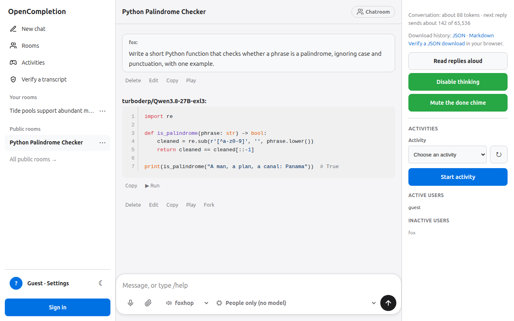
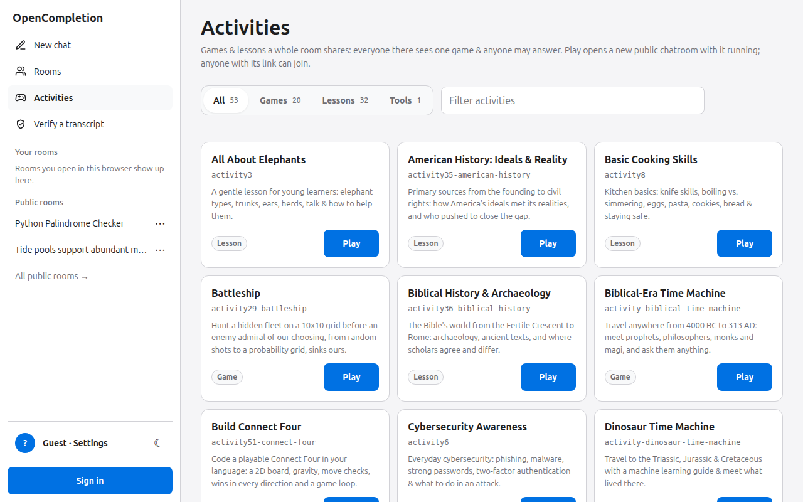
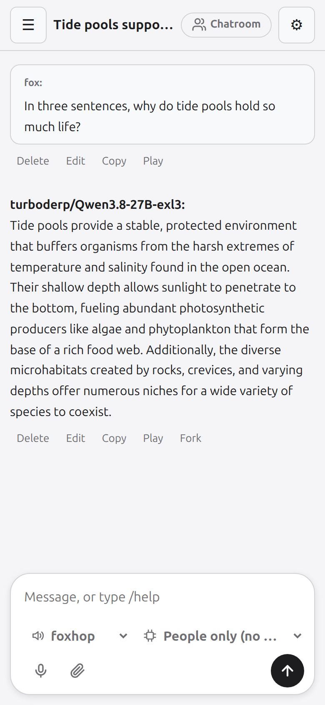

OpenCompletion
==============

A multiplayer chat for language models. Open a room, share its link, and
everyone in it talks with each other and with any model your endpoints
serve, live. Models search the web, run code and work in a sandbox as they
answer; rooms can play games and lessons together; and every room's history
is hash-chained, so a downloaded transcript can be checked by anyone.

* demo: `demo.opencompletion.com <https://demo.opencompletion.com>`_
* site: `opencompletion.com <https://opencompletion.com>`_
* public domain

Features
--------

**Chat**

- Your first message on our home page starts a chat: **Solo** (only you,
  signed in) or a **Chatroom** anyone with its link can join. A room is
  titled from its conversation.
- Any model on any OpenAI-compatible endpoint: vLLM, llama.cpp, Ollama,
  OpenAI, Gemini, Mistral, Groq & more, side by side. A model two endpoints
  serve fails over between them.
- Replies stream to everyone in the room, thinking included (collapsed);
  **Stop** ends one & keeps what it wrote.
- A message sent while a model is still working **steers** that reply: it
  reads the message after its current tool call, & a running delegate is
  passed it within seconds. ``/btw <question>`` asks
  about the work in progress instead, without changing it.
- **Edit & resend**, **Fork** a reply into a new chat, **Delete** with
  **Restore**; nothing is ever lost, earlier versions stay readable.
- Markdown, math (KaTeX), highlighted code with **▶ Run**, file & image
  attachments, voice input & replies read aloud.
- Image models (gpt-image & the like) draw instead of chat.
- Installable as an app on phones & desktops.

**Tools a model may call** (``docs/TOOLS.md``)

- Web search & page fetching. A guest's search runs in their own browser,
  never on our network.
- Code runs on `unsandbox <https://unsandbox.com>`_: one-off runs in 42+
  languages, & for trusted people a sandbox per chat that keeps its files
  and can hand a long task to uncloseai-cli, which the chat's model
  oversees.

**Activities**

- Games & lessons a whole room plays together: everyone sees one game &
  anyone may answer. Written in YAML (``research/SPEC.yaml``), graded by a
  model or a decision classifier, browsed on our **Activities** page.

**Trust**

- Every event in a room is one line of a hash chain. Downloads (JSON or
  Markdown) carry Merkle proofs, & **Verify a transcript** checks one in
  your browser with nothing uploaded.

Quick start
-----------

You need Python 3.11 or newer, ``make``, & at least one OpenAI-compatible
model endpoint.

::

    git clone https://github.com/russellballestrini/opencompletion.git
    cd opencompletion
    make venv                       # venv/ with every dependency
    cp vars.sh.sample vars.sh       # then set MODEL_ENDPOINT_1 & MODEL_API_KEY_1
    chmod 600 vars.sh               # it holds keys: owner-only
    source vars.sh && venv/bin/python app.py

Open ``http://127.0.0.1:5001``. Our database (SQLite in ``instance/``) is
created on first start. Activities are the YAML files in ``research/``;
``--port`` picks another port.

Configuration
-------------

Every setting is an environment variable, & ``vars.sh.sample`` lists them
all, grouped (models, replies, speech, tools, sandboxes, limits, sign in),
each commented out at its default. Uncomment a line only to change it.

A few worth knowing:

- ``MODEL_ENDPOINT_n`` / ``MODEL_API_KEY_n`` (n = 1, 2, 3 ...): each
  endpoint's models fill the picker. ``MODEL_NAME_n`` says which model a
  ``MODEL_n`` reference means where an endpoint lists many.
- ``OPENCOMPLETION_SERVER_EGRESS_USERS``: the signed-in emails whose
  models may use our server's network & get sandboxes. Default: nobody.
- ``UNSANDBOX_PUBLIC_KEY`` / ``UNSANDBOX_SECRET_KEY``: turn on code runs &
  sandboxes. ``OPENCOMPLETION_GUEST_CODE_EXEC=off`` keeps runs to signed-in
  people.
- ``SMTP_*``: sends sign-in codes by email; unset, they print to our
  server's console.
- ``OPENCOMPLETION_BRAND``: the name atop every page.

Commands
--------

Typed in any chat:

- ``/btw <question>``: ask about the work in progress without steering it.
  Everyone in the room sees the aside; nothing keeps it.
- ``/title new``: retitle this chat from its conversation.
- ``/cancel``: stop the reply streaming in.
- ``/help``: where everything is.
- ``/activity <path>``, ``/activity info``, ``/activity cancel``: start,
  grade or end an activity (our Activities page & a room's controls do the
  same).

Activities
----------

An activity is a YAML file of sections & steps: content, questions, the
buckets an answer can fall in & where each leads, plus scripts for games.
Read ``research/SPEC.yaml`` before writing one, then::

    venv/bin/python activity_yaml_validator.py research/<file>.yaml
    make activity-walk              # plays every activity with dice, no model
    source vars.sh && venv/bin/python research/guarded_ai.py research/<file>.yaml

Good examples: ``activity26-magic-8-ball.yaml``,
``activity31-scientific-method.yaml``, ``activity52-vault-heist.yaml`` &
``activity29-battleship.yaml``, where five enemy admirals hunt your fleet,
from random shots to a probability grid read by a decision model.

Database
--------

Each start brings our database up to date: a SQLite file is first copied
aside (``instance/chat.db.before-<revision>.bak``), then migrated. A
migration that fails stops the start & keeps that copy.
``OPENCOMPLETION_AUTO_MIGRATE=off`` turns this off; then ``make
upgrade-db`` migrates by hand. ``SQLALCHEMY_DATABASE_URI`` picks another
database. ``/version`` says which commit is running & what its start did
to the database; ``/health`` answers 200 while the database does, &
``/health/models`` while a chat model is listed (counts & the list's age
only, from memory: no endpoint is asked).

Docker
------

``vars.sh`` is mounted at run time, never baked into an image; the
container migrates its own database at start::

    docker build -t opencompletion .
    docker run --name opencompletion -p 5001:5001 \
        -v "$PWD/vars.sh:/opt/server/vars.sh:ro" \
        -v opencompletion-data:/opt/server/instance \
        opencompletion

The named volume keeps our database across containers.

Development
-----------

::

    make test        # unit, integration & functional tests, YAML validation; no network
    make test-ui     # every page in headless Chromium, phone to desktop widths
    make lint        # black --check & flake8
    make ci          # what GitHub Actions checks, one stage after another

- ``app.py``: chat itself (the chat page, Socket.IO events, model
  streaming) & the model map.
- ``routes/``: HTTP blueprints: pages, sign in, rooms, files, code.
- ``templates/`` & ``static/``: pages extend ``layout.html``; one
  stylesheet, ``static/css/style.css``; chat's scripts in
  ``static/js/chat/``. ``/styleguide`` shows every component &
  ``docs/STYLEGUIDE.md`` holds our UI rules.
- ``tools/``: what a model may call (``docs/TOOLS.md``).
- ``research/``: activity YAMLs & ``guarded_ai.py``, which plays one in a
  terminal.

Pushing to ``origin`` pushes to GitHub & to git.unturf.com together.
Contributions are welcome: fork, branch & open a pull request.

License
-------

Public domain: free for any use, without restriction.

.. figure:: https://api.star-history.com/svg?repos=russellballestrini/opencompletion&type=Date
   :alt: Star History Chart
